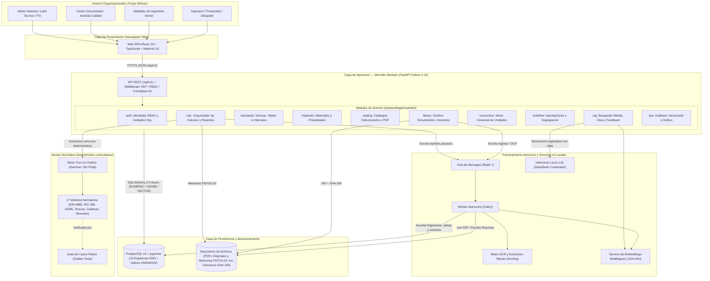
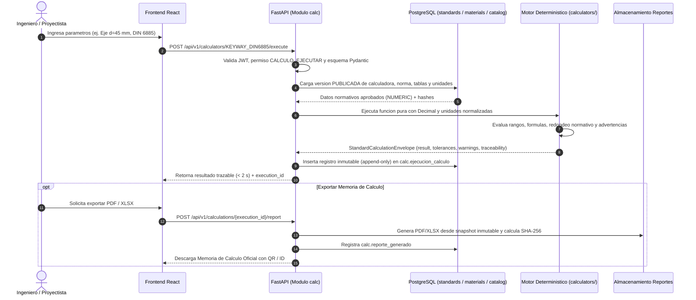
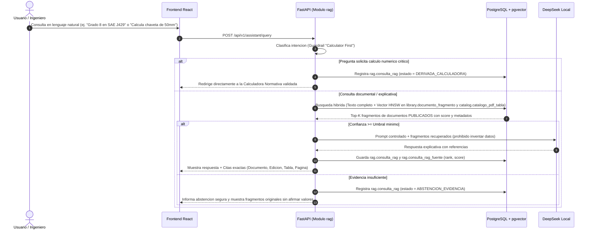

# Diagrama de Arquitectura del Proyecto — Biblioteca Virtual de Ingeniería (Forjas Bolívar)

Este documento visualiza la arquitectura lógica, de contenedores, de dominios (monolito modular) y de flujos de ejecución definida en el **Software Architecture Document (SAD v1.0)** y el **Database Design Document (DDD v2.0)**.

---

## 1. Vista General de Arquitectura y Contenedores (C4 Nivel 2 + Módulos)

---

## 2. Flujo de Cálculo Normativo Determinístico ("Calculator First")

---

## 3. Flujo Documental y Consulta Asistente IA (RAG con Citas y Guardrails)

