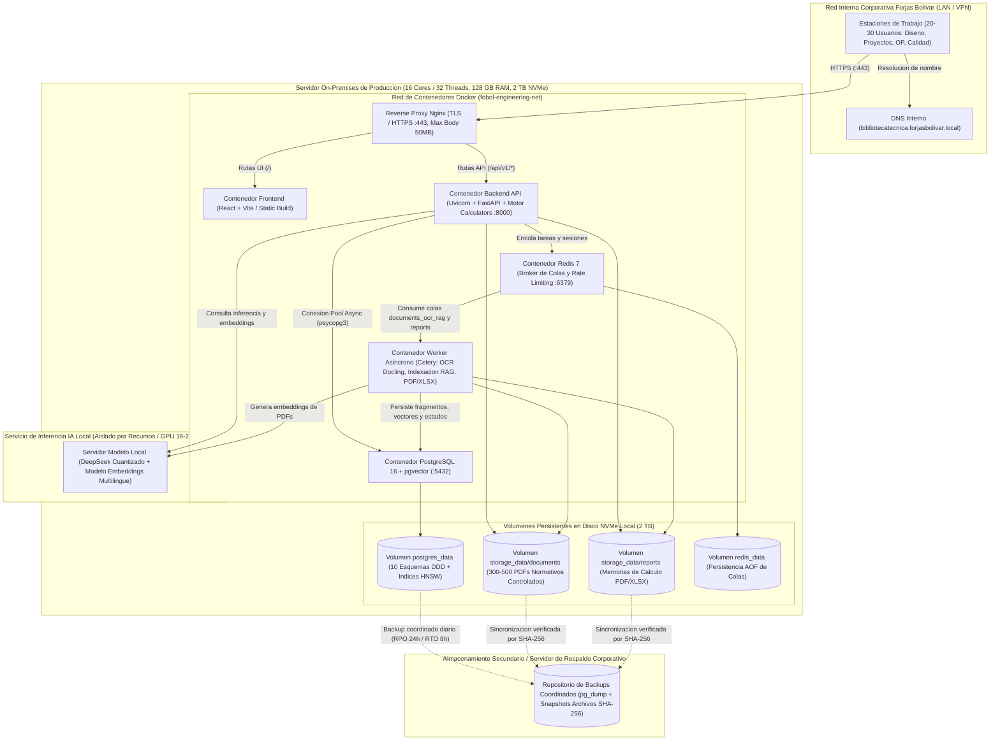

# Diagrama de Despliegue e Infraestructura — Biblioteca Virtual de Ingeniería (Forjas Bolívar)

Este documento presenta la topología de despliegue **On-Premises** dentro de la red corporativa de **Forjas Bolívar**, alineada con la sección **10. Despliegue e infraestructura** del **Software Architecture Document (SAD v1.0)**.

---

## 1. Topología de Despliegue en Producción (Servidor Interno Corporativo)

---

## 2. Flujo de Promoción entre Ambientes (Desarrollo → QA → Producción)

```mermaid
flowchart LR
    subgraph DevEnv["1. Ambiente de Desarrollo"]
        DEV_CODE["Codigo Fuente (frontend, backend, calculators, database)"]
        DEV_TEST["Pruebas Unitarias + Linter (Ruff/Mypy) + Golden Tests"]
    end

    subgraph QAEnv["2. Ambiente de QA / Piloto"]
        QA_MIG["Migraciones Alembic (Prueba Upgrade / Rollback)"]
        QA_UAT["Validacion de Casos Patron y Sesion Guiada con Usuarios"]
        QA_SEC["Pruebas de Seguridad RBAC, Segregacion y Rendimiento (p95 < 2s)"]
    end

    subgraph Gates["Compuertas de Aprobacion Dual (DDD §5.2 y §5.3)"]
        GATE_ENG["Aprobacion Tecnica: VALIDADOR_INGENIERIA"]
        GATE_IT["Autorizacion Despliegue: LIDER_TECNICO + PRODUCT_OWNER"]
    end

    subgraph ProdEnv["3. Ambiente de Produccion (On-Premises)"]
        PROD_DEPLOY["Despliegue de Imagenes Versionadas + Feature Flags"]
        PROD_MON["Observabilidad: Logs JSON, Telemetria LSS, CSAT y Alertas"]
    end

    DEV_CODE --> DEV_TEST
    DEV_TEST -->|"Build de Imagenes Docker"| QA_MIG
    QA_MIG --> QA_UAT
    QA_UAT --> QA_SEC
    QA_SEC --> GATE_ENG
    GATE_ENG --> GATE_IT
    GATE_IT -->|"Promocion controlada con Rollback listo"| PROD_DEPLOY
    PROD_DEPLOY --> PROD_MON
```

---

## 3. Especificaciones de Dimensionamiento (SAD §10.1)

| Recurso | Configuración Base (Piloto / Sin GPU) | Configuración Productiva Recomendada (Con RAG Local) |
| :--- | :--- | :--- |
| **CPU** | 12 núcleos | 16 núcleos / 32 hilos |
| **Memoria RAM** | 64 GB | 128 GB (aplicación, PostgreSQL, OCR e inferencia local) |
| **GPU** | No requerida para calculadoras normativas | 16–24 GB VRAM (para modelo DeepSeek cuantizado local) |
| **Almacenamiento** | 1 TB NVMe | 2 TB NVMe + nodo externo para backups coordinados |
| **Red** | 1 GbE corporativa | 1 GbE (o 10 GbE hacia almacenamiento de respaldos) |
| **RPO / RTO** | RPO 24 horas / RTO 8 horas | Respaldo coordinado de PostgreSQL + archivos (`SHA-256`) |

